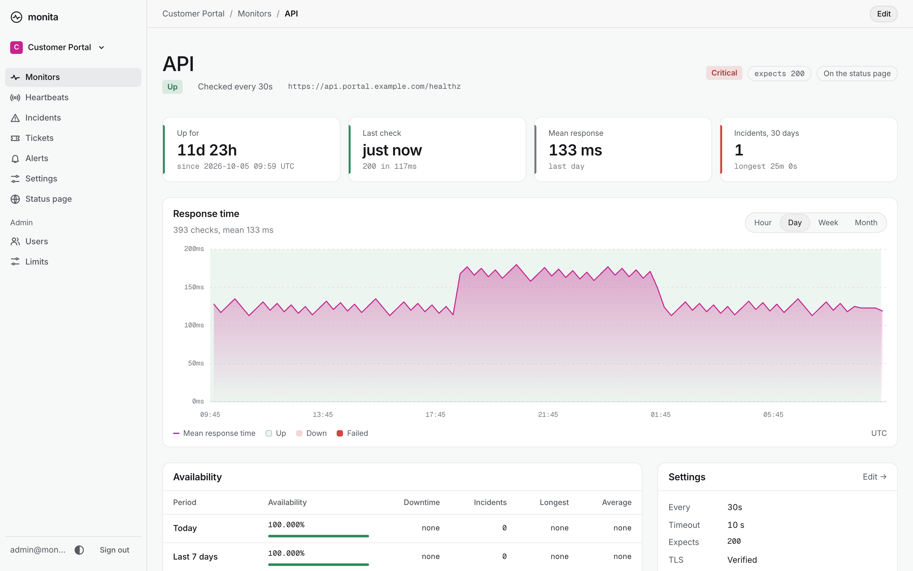
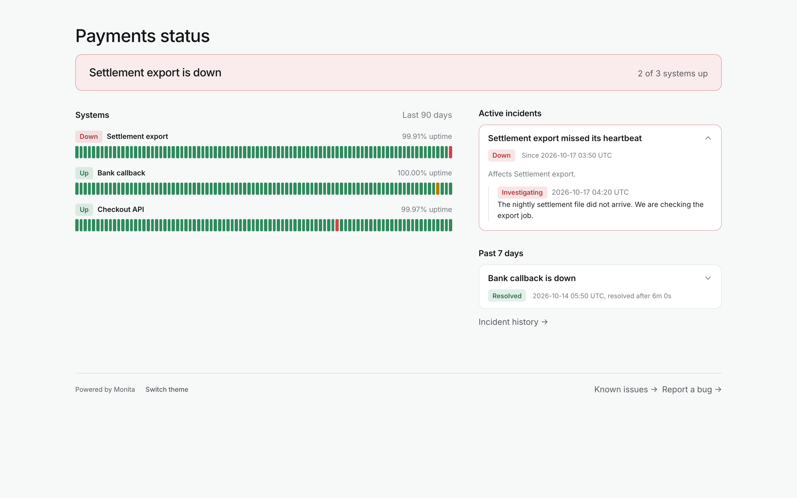
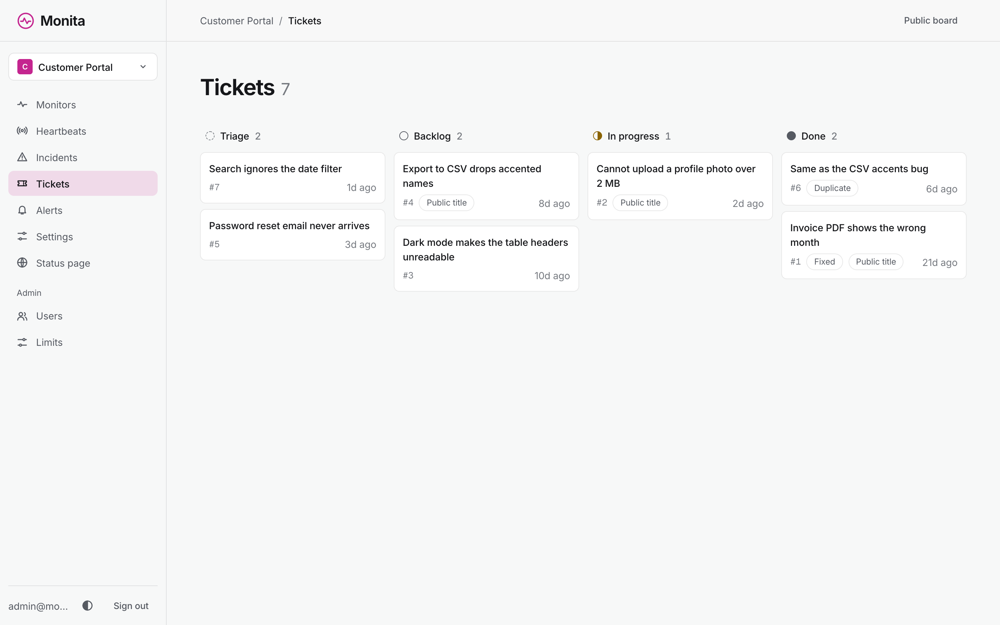

<div align="center">

<picture>
  <source media="(prefers-color-scheme: dark)" srcset="docs/assets/brand/logo-on-dark.svg">
  
</picture>

### Site reliability for every project your team ships.

Monita checks your team's websites and scheduled jobs, alerts your team when one fails, and shows the outage on a public status page.
You run it on your own server as one program, and it keeps all its data in one SQLite file.

[](https://github.com/PT-Perkasa-Pilar-Utama/monita/actions/workflows/ci.yml)
[](LICENSE)

**[Website](https://pt-perkasa-pilar-utama.github.io/monita/)** &nbsp;&nbsp;
**[Try the demo](https://pt-perkasa-pilar-utama.github.io/monita/demo/)** &nbsp;&nbsp;
**[Docs](https://pt-perkasa-pilar-utama.github.io/monita/docs/)** &nbsp;&nbsp;
**[Install](#install)**


</div>

Monita does the same job as a hosted uptime service such as Better Stack, but it runs on a server
that your team controls.

- A monitor checks a URL, a TCP port, a DNS name or a host by ping, every 30 seconds to 5 minutes.
  An HTTPS monitor can warn before its certificate expires.
- A heartbeat expects your cron job to call a Monita URL on a schedule.
- When a monitor fails twice in a row, or a heartbeat call does not arrive in time, Monita opens an
  incident. It emails the addresses you list for the project, and it posts to Slack, Discord,
  Telegram, ntfy or PagerDuty if you add a webhook.
- Locations check from other machines too, and an incident opens only when enough places agree.
- Maintenance windows keep planned work from opening incidents or sending alerts.
- A tech lead can pause a monitor or heartbeat, so it opens no incident and sends no alert until it resumes.
- Each project has a public status page. The page shows 90 days of uptime and the updates your team
  writes during an incident.
- Users can report a bug from the status page, and the tech lead sorts the reports on the ticket board.
- People sign in with a password and, if they choose, an authenticator code.

The [demo](https://pt-perkasa-pilar-utama.github.io/monita/demo/) is a saved copy of the real pages
with sample data. You can click through it, but it does not save anything you enter.



| Status page | Tickets |
| --- | --- |
|  |  |

## Install

Monita needs a 64-bit Linux server with systemd (x86 or Arm), 512 MB of memory and 5 GB of disk.
Releases also carry macOS and Windows builds for amd64 and arm64, for trying it on a laptop.
For 500 monitors, give it 2 vCPU, 1 GB of memory and 20 GB of disk.

Download the archive from
[Releases](https://github.com/PT-Perkasa-Pilar-Utama/monita/releases), unpack it, and install the binary.
On an Arm server, use `monita_linux_arm64.tar.gz`:

```sh
curl -fsSLO https://github.com/PT-Perkasa-Pilar-Utama/monita/releases/latest/download/monita_linux_amd64.tar.gz
tar -xzf monita_linux_amd64.tar.gz
sudo install -m 0755 monita /usr/local/bin/monita
sudo monita setup
sudo monita service install
```

With Docker, on Windows and macOS too, try it on a laptop with:

```sh
docker volume create monita-data
docker run --rm -it -v monita-data:/data -e MONITA_ENV=dev ghcr.io/pt-perkasa-pilar-utama/monita:1 admin create --email you@company.co.id
```

The last command asks for a password of at least 8 characters. Then start Monita and open
`http://localhost:7466`:

```sh
docker run -d --name monita -p 127.0.0.1:7466:7466 -v monita-data:/data -e MONITA_ENV=dev ghcr.io/pt-perkasa-pilar-utama/monita:1
``` The [install guide](https://pt-perkasa-pilar-utama.github.io/monita/docs/install/#with-docker) has a Compose file for a server.

`monita setup` asks for the public URL, the mail server and the first super admin.
`monita service install` makes Monita start now and after every reboot.

Monita listens on `127.0.0.1:7466`. Put a web server that handles HTTPS, such as Caddy or nginx, in
front of it. The [install guide](https://pt-perkasa-pilar-utama.github.io/monita/docs/install/)
explains these steps and how to build Monita from source. The [operations guide](https://pt-perkasa-pilar-utama.github.io/monita/docs/operations/)
explains backups, restores and upgrades.

## Send a ping from a cron job

```sh
URL=https://monita.example.com/ping/<token>
if ! out=$(backup.sh 2>&1); then
  printf '%s' "$out" | curl -fsS -m 10 --data-binary @- "$URL/fail"
  exit 1
fi
curl -fsS -m 10 "$URL"
```

If the job does not call the URL before its deadline, Monita opens an incident. A call to `/fail`
opens an incident at once. Monita stores the first 1 KB of that request as the cause of the
incident, so the command above sends the job's error output.

## Benchmark

Monita, Uptime Kuma and Gatus each checked 500 URLs every 60 seconds against one local nginx.
Each ran alone in Docker Desktop on an Apple M1 (arm64, a VM with 2 vCPU), with SQLite storage.

| 500 checks a minute | Monita 1.0.1 | Uptime Kuma 2.5.6 | Gatus (latest on 2026-10-20) |
| --- | --- | --- | --- |
| Memory under load (median) | 21 MiB | 160 MiB | 44 MiB |
| Memory idle | 18 MiB | 124 MiB | 5 MiB |
| CPU, share of one core | 0.8% | 6.6% | 1.8% |
| Checks done per minute, of 500 | 498 | 393 | 493 |
| Image size (arm64, as Docker reports it) | 10.9 MB | 603 MB | 24.5 MB |

How it was measured, on 2026-10-20:

- Memory and CPU come from `docker stats`, sampled every 15 seconds after a warm-up. Monita had a
  5-minute warm-up and 5 minutes of samples. Uptime Kuma and Gatus had 2.5 minutes of each.
- The checks per minute count the requests nginx received while the samples ran.
- Uptime Kuma got its 500 monitors as copies of one monitor made through its API, then a restart.
  It did 393 checks a minute in that window, so it had not caught up with all 500.
- Real sites over HTTPS cost more CPU and memory than a local nginx, for every tool.

## Docs

The [documentation](https://pt-perkasa-pilar-utama.github.io/monita/docs/) explains how to start,
how to connect your jobs and tools, and how to run Monita in production. Its source files are in
[docs/guide/](docs/guide/).

| Start | Connect | Reference |
| --- | --- | --- |
| [Getting started](docs/guide/getting-started.md) | [Heartbeats and cron](docs/guide/heartbeats.md) | [Technical specs](docs/technical-specs/_index.md) |
| [Install](docs/guide/install.md) | [Status JSON](docs/guide/status-page.md) | [API specs](docs/api-specs/_index.md) |
| [Configuration](docs/guide/configuration.md) | [Tickets API](docs/guide/tickets.md) | [Design system](docs/design-system/) |
| [Operations](docs/guide/operations.md) | [Webhooks](docs/guide/incidents.md) | [Decisions](docs/decisions/) |

## Contributing

You need Rust, Bun 1.4, a C compiler and Google Chrome. The Rust version in `rust-toolchain.toml` installs itself.

```sh
make setup    # install the git hooks and the browser-test packages
make run      # start Monita on http://127.0.0.1:7466
make check    # check formatting and lints, then run the Rust tests
make e2e      # run the browser tests on port 18080
```

[CONTRIBUTING.md](CONTRIBUTING.md) explains how to send a change. [CLAUDE.md](CLAUDE.md) lists the project rules, [docs/GLOSSARY.md](docs/GLOSSARY.md) the terms, and [seeds/README.md](seeds/README.md) the sample accounts.

Report a security problem privately, as [SECURITY.md](SECURITY.md) describes. Everyone who takes part follows the [Code of Conduct](CODE_OF_CONDUCT.md). [GOVERNANCE.md](GOVERNANCE.md) names the maintainers, [ROADMAP.md](ROADMAP.md) the direction and [CHANGELOG.md](CHANGELOG.md) each release.

## License

Monita is released under the MIT license. Copyright PT. Perkasa Pilar Utama.

The binary embeds the Inter and Geist Mono fonts, which are under the SIL Open Font License 1.1. Their licences are in [licenses/](licenses/) and in every release archive.
