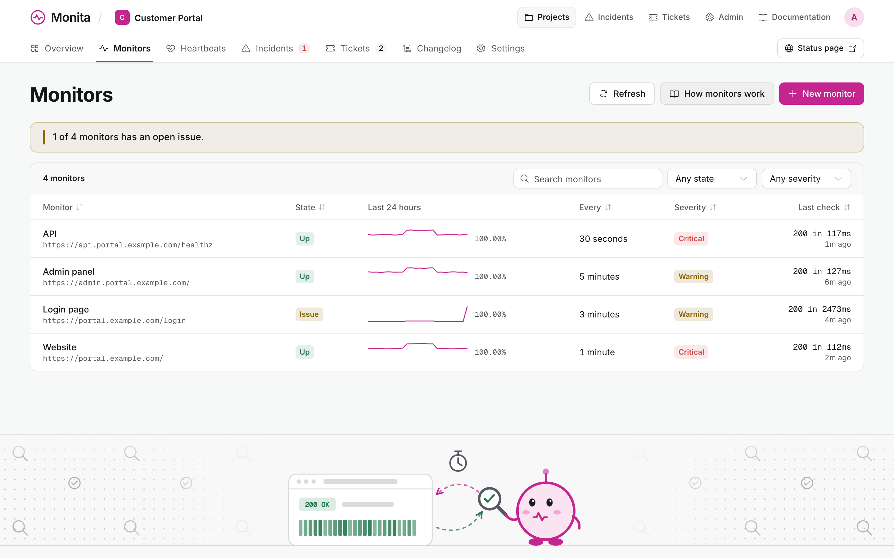

<div align="center">


**Uptime, heartbeats, incidents, status pages and bug tickets for every project in your team.**
One self-hosted binary, one SQLite file.

[](https://github.com/PT-Perkasa-Pilar-Utama/monita/actions/workflows/ci.yml)
[](LICENSE)

**[Try the demo](https://pt-perkasa-pilar-utama.github.io/monita/demo/)** &nbsp;·&nbsp;
**[Install](#install)** &nbsp;·&nbsp;
**[Docs](#docs)**

</div>

Monita watches your projects and tells people when one breaks. It is a small, self-hosted take on
Better Stack.

- **Check:** HTTP monitors every 30 s to 5 min, and heartbeats that cron jobs ping.
- **Alert:** an incident opens on two failed checks or one missed ping. Email and webhook alerts follow.
- **Tell users:** each project gets a public status page with 90 days of uptime and your updates.
- **Collect bugs:** users file tickets through the status page; you sort them on a kanban.

The [demo](https://pt-perkasa-pilar-utama.github.io/monita/demo/) is a read-only snapshot of the
real app on sample data.


| Monitors | Tickets |
| --- | --- |
|  |  |

## Install

On a Linux VM, with the binary from [Releases](https://github.com/PT-Perkasa-Pilar-Utama/monita/releases):

```sh
install -m 0755 monita /usr/local/bin/monita
sudo monita setup             # public URL, SMTP, folders, first super admin
sudo monita service install   # systemd unit, started now and at every boot
```

Put your HTTPS reverse proxy in front of `127.0.0.1:8080`. Backups, restore and upgrades:
[Install and run](docs/INSTALL.md).

## Ping from a cron job

```sh
if backup.sh; then curl -fsS -m 10 https://monita.example.com/ping/<token>
else curl -fsS -m 10 https://monita.example.com/ping/<token>/fail; fi
```

No ping within the period you set opens an incident, and so does `/fail` at once. A failing job can
send its error as the request body: the first 1 KB becomes the incident's cause.

## Docs

| Run it | Integrate | Reference |
| --- | --- | --- |
| [Install and run](docs/INSTALL.md) | [Ping API](docs/api-specs/04-checks.md) | [Technical specs](docs/technical-specs/_index.md) |
| [Configuration](docs/technical-specs/11-environment-configuration.md) | [Status JSON](docs/api-specs/07-status.md) | [API specs](docs/api-specs/_index.md) |
| [Command line](docs/api-specs/10-cli.md) | [Tickets API](docs/api-specs/08-tickets.md) | [Design system](docs/design-system/) |
| [Security](docs/technical-specs/07-security.md) | [Webhook payload](docs/api-specs/06-notify.md) | [Decisions](docs/decisions/) |

## Contributing

Rust (the toolchain in `rust-toolchain.toml` installs itself), Bun 1.4 and Google Chrome:

```sh
make setup    # git hooks and e2e packages
make run      # http://127.0.0.1:8080
make check    # format, clippy, unit and integration tests
make e2e      # browser tests on port 18080
```

[CLAUDE.md](CLAUDE.md) lists every rule and command. Seeded accounts: [seeds/README.md](seeds/README.md).

## License

MIT. Copyright PT. Perkasa Pilar Utama.
