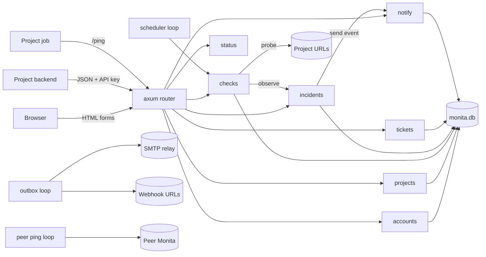
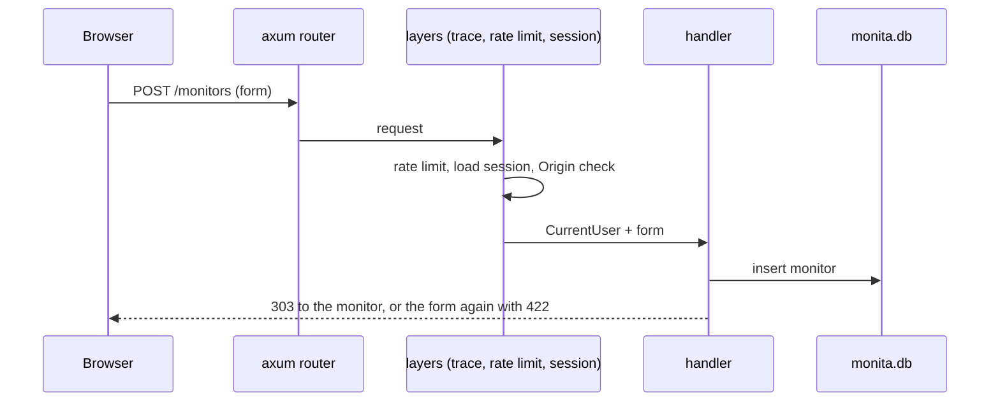
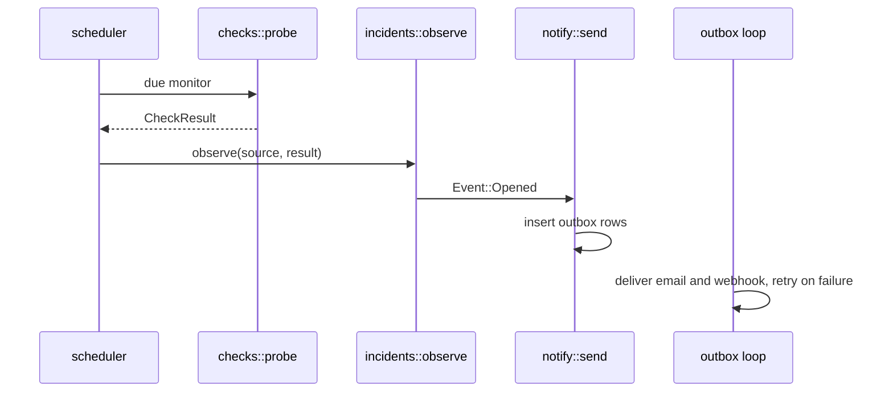
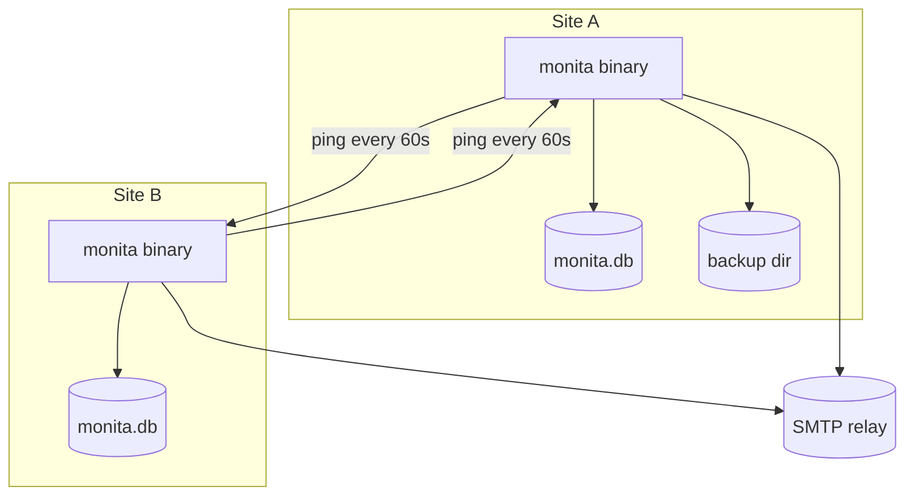

# 2. System Architecture

## 2.1 Style

Modular monolith in one process. The HTTP server and the background loops run in the same binary and share one database file.

### Why this shape

| Option | Verdict |
| --- | --- |
| Modular monolith, one process | Chosen. One binary, one systemd unit, one file to back up. 500 monitors fit in one process. |
| Separate worker process | Rejected. Two units to run and a second path to the database for no gain at this size. |
| Microservices | Rejected. Network seams between parts that share one small dataset. |

## 2.2 Component graph

## 2.3 Request lifecycle

A check runs outside any request:

## 2.4 Deployment graph

## 2.5 Replication model

Each Monita is independent. Two Monitas at two sites watch each other through a heartbeat: each one calls `MONITA_PING_URL`, which points at a heartbeat on the other. If one dies, the other sends a "heartbeat missed" alert.

Not in v1: remote probes, hot standby, and shared databases. The check runner sits behind `checks::probe(target) -> CheckResult`, so a remote probe can feed results later without a rewrite.

## 2.6 Boundary map

| Module | Owns tables | Others call |
| --- | --- | --- |
| accounts | users, invites, sessions | `CurrentUser`, `AdminUser`, `is_active_tl`, `purge_expired` |
| projects | projects, api_keys | `ApiProject`, `find_for`, `can_manage` |
| checks | monitors, heartbeats, check_results, pings, daily_summaries | `probe`, `accept_ping`, `list_monitors`, `heartbeat::list` |
| incidents | incidents, incident_items, incident_sources, status_updates | `observe`, `states_for`, `source_deleted` |
| notify | alert_routes, outbox | `send`, `create_routes`, `purge_delivered` |
| status | none | none |
| tickets | ref_ids, tickets | none |
| platform | settings, schema_migrations | `settings`, rate limit layer, `render` |

Rule: a module writes only its own tables and reads only its own, except a read-only `JOIN users` for an email or name. It calls another module through that module's `pub` functions in `mod.rs`. It never imports another module's `store` or `engine` files.
