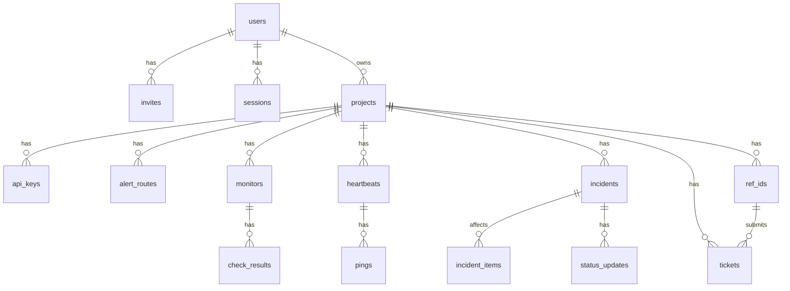
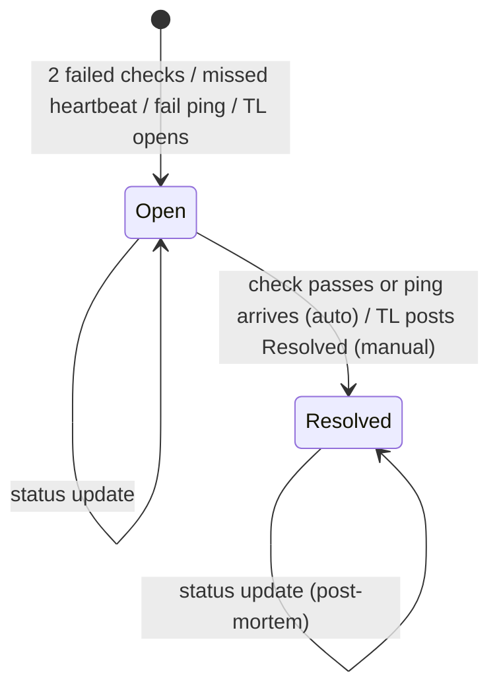
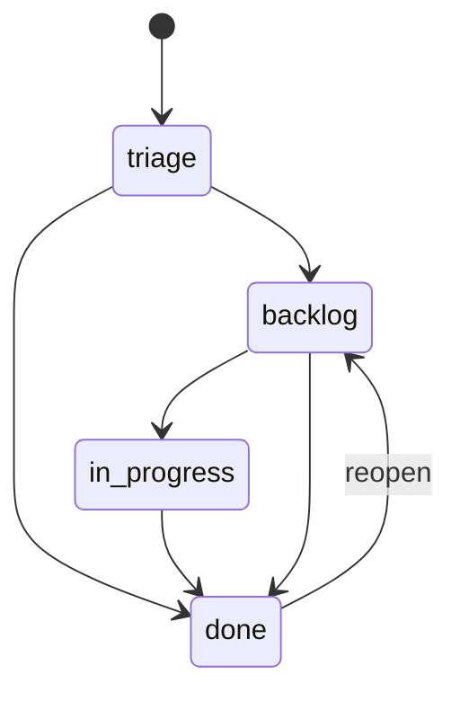

# 6. Data Model

## 6.1 Conventions

| Rule | Detail |
| --- | --- |
| Primary key | `id INTEGER PRIMARY KEY` |
| Time | `INTEGER`, UTC Unix seconds. Columns end in `_at`. |
| Booleans | `INTEGER` 0 or 1 with a `CHECK`. |
| Enums | `TEXT` with a `CHECK (x IN (...))`. |
| Common columns | `created_at` on every table, `updated_at` where rows change. |
| Secrets | Only SHA-256 hashes for API keys, invites, sessions and ref IDs. Heartbeat tokens are stored raw, because the TL must see the ping URL again. |
| Foreign keys | `PRAGMA foreign_keys = ON`. `ON DELETE CASCADE` from a project to its children. |

## 6.2 ERD

`incident_items`, `incident_sources` and `daily_summaries` point at a monitor or a heartbeat through `(source_kind, source_id)`.

## 6.3 Tables

### 6.3.1 users

| column | type | nullable | default | key | notes |
| --- | --- | --- | --- | --- | --- |
| id | INTEGER | no | | PK | |
| email | TEXT | no | | UNIQUE | lowercased. `tl@company.co.id` |
| password_hash | TEXT | yes | | | NULL until the invite is used |
| role | TEXT | no | | | `super_admin`, `tl` |
| disabled_at | INTEGER | yes | | | |
| created_at, updated_at | INTEGER | no | | | |

### 6.3.2 invites

| column | type | nullable | default | key | notes |
| --- | --- | --- | --- | --- | --- |
| id | INTEGER | no | | PK | |
| user_id | INTEGER | no | | FK users | |
| token_hash | TEXT | no | | UNIQUE | |
| expires_at | INTEGER | no | | | created_at + 72 h |
| used_at | INTEGER | yes | | | |
| created_at | INTEGER | no | | | |

### 6.3.3 sessions

| column | type | nullable | default | key | notes |
| --- | --- | --- | --- | --- | --- |
| id | INTEGER | no | | PK | |
| user_id | INTEGER | no | | FK users | |
| token_hash | TEXT | no | | UNIQUE | |
| expires_at | INTEGER | no | | | created_at + 14 days |
| created_at | INTEGER | no | | | |

### 6.3.4 projects

| column | type | nullable | default | key | notes |
| --- | --- | --- | --- | --- | --- |
| id | INTEGER | no | | PK | |
| owner_id | INTEGER | no | | FK users | |
| name | TEXT | no | | | `Payments` |
| slug | TEXT | no | | UNIQUE | `^[a-z0-9-]{2,40}$`. Made at create: the name in lowercase letters, digits and dashes, cut to 33 characters, then `-` and 6 random base32 characters. `payments-k3x9qa` |
| ip_allowlist | TEXT | yes | | | Comma-separated CIDRs. NULL means off. |
| created_at, updated_at | INTEGER | no | | | |

### 6.3.5 api_keys

| column | type | nullable | default | key | notes |
| --- | --- | --- | --- | --- | --- |
| id | INTEGER | no | | PK | |
| project_id | INTEGER | no | | FK projects | |
| name | TEXT | no | | | `backend-prod` |
| key_hash | TEXT | no | | UNIQUE | |
| key_prefix | TEXT | no | | | First 10 chars, for display. `mk_7hq2kz` |
| last_used_at | INTEGER | yes | | | |
| revoked_at | INTEGER | yes | | | |
| created_at | INTEGER | no | | | |

### 6.3.6 alert_routes

| column | type | nullable | default | key | notes |
| --- | --- | --- | --- | --- | --- |
| id | INTEGER | no | | PK | |
| project_id | INTEGER | no | | FK projects | UNIQUE with severity |
| severity | TEXT | no | | | `critical`, `warning` |
| emails | TEXT | no | `''` | | Newline-separated |
| webhook_url | TEXT | yes | | | |
| use_webhook | INTEGER | no | | | Default 1 for critical, 0 for warning |

### 6.3.7 monitors

| column | type | nullable | default | key | notes |
| --- | --- | --- | --- | --- | --- |
| id | INTEGER | no | | PK AUTOINCREMENT | Never reused (migration 0003): incident_items, incident_sources and daily_summaries name a source by kind and id without a foreign key. |
| project_id | INTEGER | no | | FK projects | |
| name | TEXT | no | | | `API health` |
| url | TEXT | no | | | `https://pay.internal/api/health` |
| interval_s | INTEGER | no | 60 | | `CHECK IN (30, 60, 180, 300)` |
| timeout_ms | INTEGER | no | 10000 | | 1000 to 30000 |
| expected_status | TEXT | no | `'2xx'` | | `2xx`, or a list like `200,204` |
| keyword | TEXT | yes | | | |
| skip_tls_verify | INTEGER | no | 0 | | For self-signed internal endpoints |
| severity | TEXT | no | `'warning'` | | |
| is_public | INTEGER | no | 0 | | |
| next_check_at | INTEGER | no | | INDEX | |
| created_at, updated_at | INTEGER | no | | | |

### 6.3.8 heartbeats

| column | type | nullable | default | key | notes |
| --- | --- | --- | --- | --- | --- |
| id | INTEGER | no | | PK AUTOINCREMENT | Never reused, as for monitors. |
| project_id | INTEGER | no | | FK projects | |
| name | TEXT | no | | | `nightly-report` |
| token | TEXT | no | | UNIQUE | 26-char base32 |
| period_s | INTEGER | no | | | 60 to 2 592 000 |
| grace_s | INTEGER | no | | | 0 to 86 400 |
| severity | TEXT | no | `'warning'` | | |
| is_public | INTEGER | no | 0 | | |
| last_ping_at | INTEGER | yes | | | |
| deadline_at | INTEGER | yes | | INDEX | NULL after a miss is reported, until the next ping |
| created_at, updated_at | INTEGER | no | | | |

### 6.3.9 check_results and pings

| table | columns |
| --- | --- |
| check_results | id, monitor_id FK, checked_at INDEX(monitor_id, checked_at), ok, status_code NULL, latency_ms NULL, error NULL |
| pings | id, heartbeat_id FK, received_at INDEX(heartbeat_id, received_at), kind (`ok`, `fail`), source_ip, cause (NULL, the first 1 KB of a `/fail` body after leading whitespace) |

Both keep 7 days. See [13 section 13.6](13-check-scheduler.md).

### 6.3.10 daily_summaries

| column | type | notes |
| --- | --- | --- |
| source_kind | TEXT | `monitor`, `heartbeat`. PK part |
| source_id | INTEGER | PK part |
| day | TEXT | `2026-10-16`, UTC. PK part |
| checks_total | INTEGER | |
| checks_ok | INTEGER | |
| downtime_s | INTEGER | From incidents that overlap the day |
| avg_latency_ms | INTEGER NULL | Monitors only |

Uptime % for a day = `1 - downtime_s / 86400`. The status page computes the same figure live from incidents; this table keeps the history after raw rows are swept (US-32). Daily-job bookkeeping lives in `settings` outside the limits page: `last_<job>_day` (UTC date of the last success), `last_<job>_attempt_at` (Unix time of the last failure) and `rollup_through` (Unix start of the last summarized day).

### 6.3.11 incidents, incident_items, incident_sources, status_updates

| table | columns |
| --- | --- |
| incidents | id, project_id FK, origin (`auto`, `manual`), title, severity, cause NULL, started_at, resolved_at NULL, created_by NULL FK users |
| incident_items | incident_id FK, source_kind, source_id. PK all three |
| incident_sources | source_kind, source_id (PK), fail_streak INTEGER default 0, open_incident_id NULL FK incidents |
| status_updates | id, incident_id FK, label (`investigating`, `identified`, `monitoring`, `resolved`), message, author_id NULL (NULL = Monita), created_at |

### 6.3.12 outbox

| column | type | notes |
| --- | --- | --- |
| id | INTEGER | PK |
| channel | TEXT | `email`, `webhook` |
| recipient | TEXT | Email address or URL |
| subject | TEXT NULL | Email only |
| body | TEXT | Plain text, or JSON for webhooks |
| attempts | INTEGER | default 0 |
| next_attempt_at | INTEGER | INDEX |
| sent_at, failed_at | INTEGER NULL | |
| last_error | TEXT NULL | |
| created_at | INTEGER | Rows older than 30 days are deleted |

### 6.3.13 ref_ids and tickets

| table | columns |
| --- | --- |
| ref_ids | id, project_id FK, token_hash UNIQUE, single_use, used_at NULL, revoked_at NULL, created_at |
| tickets | id, project_id FK, number (UNIQUE with project_id), ref_id FK, title, public_title NULL, description, page_url NULL, stage (`triage`, `backlog`, `in_progress`, `done`), close_reason NULL (`fixed`, `wont_fix`, `duplicate`), created_at, updated_at |

UI label for `stage`: "Column".

### 6.3.14 settings and schema_migrations

| table | columns |
| --- | --- |
| settings | key TEXT PK, value TEXT. Keys: `check_concurrency` (50), `rl_ip_per_min` (60), `rl_key_per_min` (120), `rl_ping_per_s` (1), `tickets_per_ref_per_day` (5), `tickets_per_project_per_day` (100). Every value is 1 to 1 000 000; `check_concurrency` is 1 to 500. |
| schema_migrations | version INTEGER PK, applied_at |

## 6.4 State machines

### 6.4.1 Incident

Rules are in [12](12-incident-engine.md).

### 6.4.2 Ticket

Any move is allowed between `triage`, `backlog` and `in_progress`. Entering `done` needs `close_reason`. Leaving `done` clears it. A ticket is public when `stage != 'triage'`.

## 6.5 Indexes

`monitors(next_check_at)`, `heartbeats(deadline_at)`, `check_results(monitor_id, checked_at)`, `pings(heartbeat_id, received_at)`, `outbox(next_attempt_at) WHERE sent_at IS NULL AND failed_at IS NULL`, `tickets(project_id, stage)`.

## 6.6 Migrations and seeding

Rule: migrations are numbered files in `migrations/`, embedded at compile time with paths relative to the source file, and applied by one runner inside the binary. The database path comes from the environment.

`platform::migrate::run` applies each pending file in its own `Db::write_without_fk` transaction and records it in `schema_migrations`. Foreign keys are off during a migration, because a table rebuild (SQLite's generalized ALTER TABLE procedure) drops a parent table, which would otherwise cascade. A rebuild copies every row with its id, so references stay valid; turso 0.8.3 answers `PRAGMA foreign_key_check` with no rows, so that check is not available.

| Command | Effect |
| --- | --- |
| `monita serve` | Runs pending migrations, then starts. |
| `monita migrate` | Runs pending migrations and exits. |
| `monita setup` | Writes the env file and creates the first super admin ([api-specs 10.2](../api-specs/10-cli.md#102-monita-setup)). |
| `monita admin create --email` | Creates a super admin. Reads the password from stdin. |
| `monita admin reset-password --email` | Sets a new password for an existing super admin and signs them out. A TL resets through a new invite. |
| `POST /admin/reset-state {"seed":"dev"}` | Dev and test only. Wipes, migrates, loads `seeds/dev.sql` or `seeds/qa.sql`. |

Forbidden: running a `.sql` file by an absolute path outside the runner, and creating tables in application code.

`seeds/dev.sql` and `seeds/qa.sql` are idempotent, embedded with `include_str!`, and hold one super admin, one TL, one project, two monitors, one heartbeat and three tickets. Seed passwords are documented in `seeds/README.md` and work only outside prod, because reset-state does not exist there.
