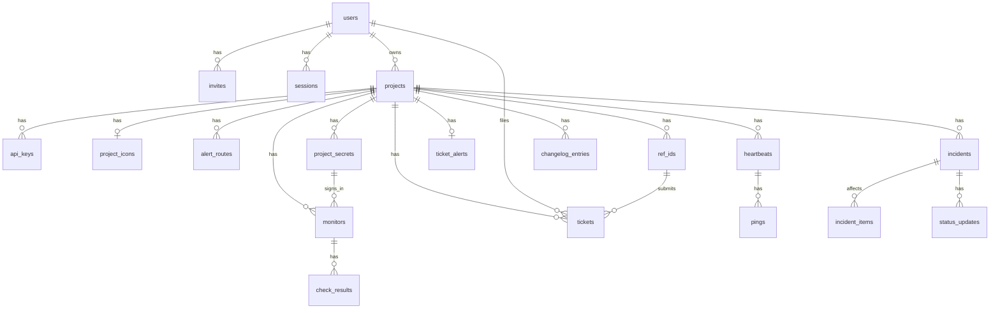
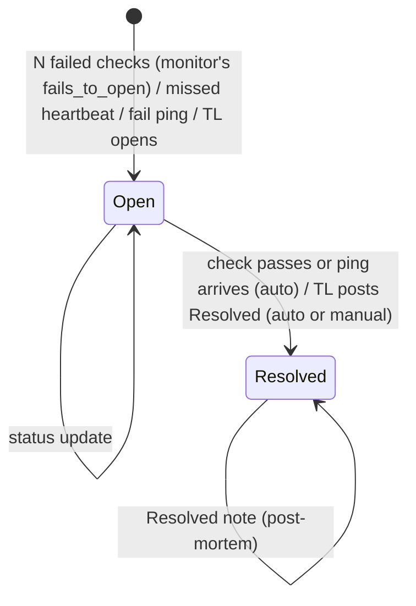
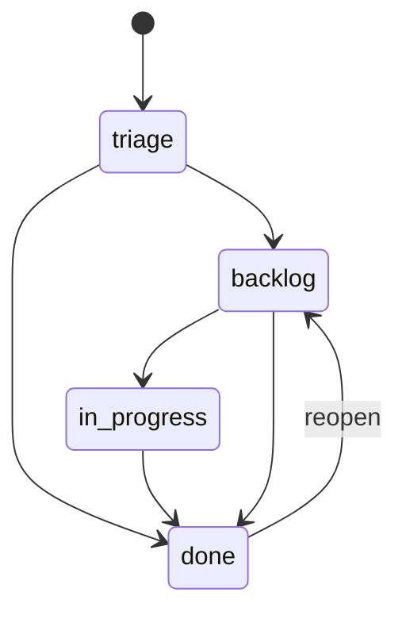

# 6. Data Model

## 6.1 Conventions

| Rule | Detail |
| --- | --- |
| Primary key | `id INTEGER PRIMARY KEY` |
| Time | `INTEGER`, UTC Unix seconds. Columns end in `_at`. |
| Booleans | `INTEGER` 0 or 1 with a `CHECK`. |
| Enums | `TEXT` with a `CHECK (x IN (...))`. |
| Common columns | `created_at` on every table, `updated_at` where rows change. |
| Secrets | Only SHA-256 hashes for API keys, invites, sessions and ref IDs. Heartbeat tokens are stored raw, because the TL must see the ping URL again. |
| Values Monita must send | Stored as entered, because a check or the mail server needs the real value: `project_secrets.value`, `monitors.headers`, `monitors.body`, `monitors.auth_user` and the mail password in `settings.mail`. See [07](07-security.md) SEC-23 to SEC-25. |
| Table rebuilds | SQLite cannot change a column `CHECK`. Migrations 0003, 0006, 0018 and 0022 rebuild `monitors`, `tickets` and `users`. Each copy keeps every id. |
| Foreign keys | `PRAGMA foreign_keys = ON`. `ON DELETE CASCADE` from a project to its children. |

## 6.2 ERD

`incident_items`, `incident_sources` and `daily_summaries` point at a monitor or a heartbeat through `(source_kind, source_id)`.

## 6.3 Tables

### 6.3.1 users

| column | type | nullable | default | key | notes |
| --- | --- | --- | --- | --- | --- |
| id | INTEGER | no | | PK | |
| email | TEXT | no | | UNIQUE | lowercased. `tl@company.co.id` |
| password_hash | TEXT | yes | | | NULL until the invite is used |
| role | TEXT | no | | | `super_admin`, `tl`, `supervisor`. A supervisor sees what a super admin sees and changes nothing ([09](09-authentication-and-authorization.md)). Migration 0022 rebuilt the table to add the value. |
| disabled_at | INTEGER | yes | | | |
| created_at, updated_at | INTEGER | no | | | |

### 6.3.2 invites

| column | type | nullable | default | key | notes |
| --- | --- | --- | --- | --- | --- |
| id | INTEGER | no | | PK | |
| user_id | INTEGER | no | | FK users | |
| token_hash | TEXT | no | | UNIQUE | |
| expires_at | INTEGER | no | | | created_at + 72 h |
| used_at | INTEGER | yes | | | |
| created_at | INTEGER | no | | | |

### 6.3.3 sessions

| column | type | nullable | default | key | notes |
| --- | --- | --- | --- | --- | --- |
| id | INTEGER | no | | PK | |
| user_id | INTEGER | no | | FK users | |
| token_hash | TEXT | no | | UNIQUE | |
| expires_at | INTEGER | no | | | created_at + 14 days |
| created_at | INTEGER | no | | | |

### 6.3.4 projects

| column | type | nullable | default | key | notes |
| --- | --- | --- | --- | --- | --- |
| id | INTEGER | no | | PK | |
| owner_id | INTEGER | no | | FK users | |
| name | TEXT | no | | | `Payments` |
| slug | TEXT | no | | UNIQUE | `^[a-z0-9-]{2,40}$`. Made at create: the name in lowercase letters, digits and dashes, cut to 33 characters, then `-` and 6 random base32 characters. `payments-k3x9qa` |
| ip_allowlist | TEXT | yes | | | Comma-separated CIDRs. NULL means off. |
| description | TEXT | yes | | | Up to 280 characters. NULL means none. |
| icon_at | INTEGER | yes | | | When the icon was last set. NULL means no icon; the value versions the icon's URL. |
| homepage_url | TEXT | yes | | | Where people use the project's system. `http://` or `https://`, up to 2 000 characters. New projects and the profile form require it. NULL for projects made before migration 0020; the status page links to it when set. |
| show_incidents | INTEGER | no | 1 | | The public Incidents tab. Off: the page JSON carries no incidents and the history answers 404. Uptime always shows. |
| show_known_issues | INTEGER | no | 1 | | The public Known issues tab (the tickets past Triage). |
| show_report | INTEGER | no | 1 | | The public Report a bug tab: the form and the reporter's own tickets, both behind a ref ID. Migration 0010 added `show_mine`; migration 0019 dropped it. |
| show_changelog | INTEGER | no | 0 | | The public Changelog tab. Off by default, so no old status page grows an empty tab. |
| created_at, updated_at | INTEGER | no | | | |

A public route whose tab is off answers 404.

### 6.3.4a project_icons

The icon's bytes, apart from `projects` so a project list never reads them.

| column | type | nullable | default | key | notes |
| --- | --- | --- | --- | --- | --- |
| project_id | INTEGER | no | | PK, FK projects ON DELETE CASCADE | |
| mime | TEXT | no | | CHECK `image/png` or `image/webp` | |
| data | BLOB | no | | | At most 32 KB. The browser scales the picture to 128 px; the server checks the type and the size only. |

### 6.3.5 api_keys

| column | type | nullable | default | key | notes |
| --- | --- | --- | --- | --- | --- |
| id | INTEGER | no | | PK | |
| project_id | INTEGER | no | | FK projects | |
| name | TEXT | no | | | `backend-prod` |
| key_hash | TEXT | no | | UNIQUE | |
| key_prefix | TEXT | no | | | First 10 chars, for display. `mk_7hq2kz` |
| last_used_at | INTEGER | yes | | | |
| revoked_at | INTEGER | yes | | | |
| created_at | INTEGER | no | | | |

### 6.3.6 alert_routes

| column | type | nullable | default | key | notes |
| --- | --- | --- | --- | --- | --- |
| id | INTEGER | no | | PK | |
| project_id | INTEGER | no | | FK projects | UNIQUE with severity |
| severity | TEXT | no | | | `critical`, `warning` |
| emails | TEXT | no | `''` | | Newline-separated. A new project's routes start with the owner's email (AC-15.02). Migration 0023 gave the owner's email to every route that had no email and no webhook in use. |
| webhook_url | TEXT | yes | | | |
| use_webhook | INTEGER | no | | | Default 1 for critical, 0 for warning |
| webhook_format | TEXT | no | `'json'` | | `json`, `discord`, `telegram`, `ntfy` or `pagerduty` (migration 0025, v1.1 Q17) |
| webhook_key | TEXT | yes | | | Telegram's chat ID or PagerDuty's routing key. A supervisor never sees it, like the URL. |
| enabled | INTEGER | no | 1 | | The route's on and off switch (migration 0008). Off keeps the emails and the webhook, and sends nothing. |

### 6.3.6a ticket_alerts

One row per project. Ticket alerts are apart from the severities (migration 0007).

| column | type | nullable | default | key | notes |
| --- | --- | --- | --- | --- | --- |
| project_id | INTEGER | no | | PK, FK projects ON DELETE CASCADE | |
| digest | INTEGER | no | 1 | | The owner's daily email of new Triage tickets |
| webhook_url | TEXT | yes | | | The ticket webhook. Kept while both webhook boxes are off. |
| use_webhook | INTEGER | no | 0 | | `CHECK (use_webhook = 0 OR webhook_url IS NOT NULL)`. One `ticket.created` call per reporter ticket. |
| webhook_moves | INTEGER | no | 0 | | One `ticket.moved` call per column move (migration 0011). The app checks that the URL is set, because SQLite cannot add that `CHECK` afterwards. |
| enabled | INTEGER | no | 1 | | The section's on and off switch (migration 0008) |

### 6.3.7 monitors

| column | type | nullable | default | key | notes |
| --- | --- | --- | --- | --- | --- |
| id | INTEGER | no | | PK AUTOINCREMENT | Never reused (migration 0003): incident_items, incident_sources and daily_summaries name a source by kind and id without a foreign key. |
| project_id | INTEGER | no | | FK projects | |
| name | TEXT | no | | | `API health` |
| url | TEXT | no | | | `https://pay.internal/api/health` |
| interval_s | INTEGER | no | 60 | | `CHECK IN (30, 60, 180, 300)` |
| timeout_ms | INTEGER | no | 10000 | | 1000 to 30000 |
| expected_status | TEXT | no | `'2xx'` | | `2xx`, or a list like `200,204` |
| keyword | TEXT | yes | | | The response must contain this text. Up to 200 characters. |
| skip_tls_verify | INTEGER | no | 0 | | For self-signed internal endpoints |
| severity | TEXT | no | `'warning'` | | |
| is_public | INTEGER | no | 0 | | |
| next_check_at | INTEGER | no | | INDEX | |
| alert | INTEGER | no | 1 | | Its failures alert (migration 0009). Off: Monita tracks it and tells nobody. |
| auto_incident | INTEGER | no | 1 | | Its failures open an incident. Off: it goes Down on the team's pages and sends the Down and Up alerts only ([12](12-incident-engine.md)). |
| fails_to_open | INTEGER | no | 2 | | Failed checks in a row that count as down. `CHECK BETWEEN 1 AND 99`. Migration 0014 allowed 1, 2, 3 and 5; migration 0018 widened it by rebuilding the table. |
| method | TEXT | no | `'GET'` | | `GET`, `HEAD`, `POST` or `PUT` |
| headers | TEXT | yes | | | `Name: value` lines, as entered. At most 20 headers and 4 KB a value. `Host` and `Content-Length` are refused. |
| body | TEXT | yes | | | Sent with `POST` and `PUT` only. At most 64 KB, as entered. |
| auth_kind | TEXT | no | `'none'` | | `none`, `bearer`, `basic` or `header`. The secret named by `auth_secret_id` supplies the credential. |
| auth_secret_id | INTEGER | yes | | FK project_secrets ON DELETE SET NULL | Must belong to the monitor's project. A deleted secret fails the check with a fixed sentence. |
| auth_user | TEXT | yes | | | The user name for `basic`. No colon. |
| auth_header | TEXT | yes | | | The header name for `header`. A header row may not repeat it. |
| kind | TEXT | no | `'http'` | | `http`, `tcp` or `dns` (migration 0024, v1.1 Q16). A TCP check keeps `host:port` in `url`, a DNS check the host name. |
| expected_address | TEXT | yes | | | `dns` only: the check passes only when one A or AAAA answer equals it (migration 0024). |
| created_at, updated_at | INTEGER | no | | | |

### 6.3.7a project_secrets

Tokens and passwords that monitors sign in with. A value is written once and never shown again.

| column | type | nullable | default | key | notes |
| --- | --- | --- | --- | --- | --- |
| id | INTEGER | no | | PK | |
| project_id | INTEGER | no | | FK projects ON DELETE CASCADE | UNIQUE with `name`. At most 20 per project. |
| name | TEXT | no | | | 1 to 60 letters, digits, `_` or `-`. `REPORT_API_TOKEN` |
| value | TEXT | no | | | 1 byte to 4 KB, stored as entered (SEC-23). Only `projects::secrets::value_of` reads it. |
| created_at, updated_at | INTEGER | no | | | |

### 6.3.8 heartbeats

| column | type | nullable | default | key | notes |
| --- | --- | --- | --- | --- | --- |
| id | INTEGER | no | | PK AUTOINCREMENT | Never reused, as for monitors. |
| project_id | INTEGER | no | | FK projects | |
| name | TEXT | no | | | `nightly-report` |
| token | TEXT | no | | UNIQUE | 26-char base32 |
| period_s | INTEGER | no | | | 60 to 2 592 000 |
| grace_s | INTEGER | no | | | 0 to 86 400 |
| severity | TEXT | no | `'warning'` | | |
| is_public | INTEGER | no | 0 | | |
| last_ping_at | INTEGER | yes | | | |
| deadline_at | INTEGER | yes | | INDEX | NULL after a miss is reported, until the next ping. A hand resolve sets it to `now + period_s + grace_s` ([12](12-incident-engine.md)). |
| alert | INTEGER | no | 1 | | As for monitors (migration 0009) |
| auto_incident | INTEGER | no | 1 | | As for monitors |
| created_at, updated_at | INTEGER | no | | | |

State words on the team's pages: `Up`, `Down`, `Issue` and `No data yet`. A monitor never checked and a heartbeat never pinged read `No data yet` (was "Waiting"). Migration 0012 gave each heartbeat that a hand resolve left with no deadline, and that was not down, a new one.

### 6.3.9 check_results and pings

| table | columns |
| --- | --- |
| check_results | id, monitor_id FK, checked_at INDEX(monitor_id, checked_at), ok, status_code NULL, latency_ms NULL, error NULL |
| pings | id, heartbeat_id FK, received_at INDEX(heartbeat_id, received_at), kind (`ok`, `fail`), source_ip, cause (NULL, the first 1 KB of a `/fail` body after leading whitespace) |

Both keep 7 days. See [13 section 13.6](13-check-scheduler.md).

### 6.3.10 daily_summaries

| column | type | notes |
| --- | --- | --- |
| source_kind | TEXT | `monitor`, `heartbeat`. PK part |
| source_id | INTEGER | PK part |
| day | TEXT | `2026-10-16`, UTC. PK part |
| checks_total | INTEGER | |
| checks_ok | INTEGER | |
| downtime_s | INTEGER | From incidents that overlap the day |
| avg_latency_ms | INTEGER NULL | Monitors only |

Uptime % for a day = `1 - downtime_s / 86400`. The status page computes the same figure live from incidents; this table keeps the history after raw rows are swept (US-32). Daily-job bookkeeping lives in `settings` outside the limits page: `last_<job>_day` (UTC date of the last success), `last_<job>_attempt_at` (Unix time of the last failure) and `rollup_through` (Unix start of the last summarized day).

### 6.3.11 incidents, incident_items, incident_sources, status_updates

| table | columns |
| --- | --- |
| incidents | id, project_id FK, origin (`auto`, `manual`), title, severity, cause NULL, started_at, resolved_at NULL, created_by NULL FK users |
| incident_items | incident_id FK, source_kind, source_id. PK all three |
| incident_sources | source_kind, source_id (PK), fail_streak INTEGER default 0, open_incident_id NULL FK incidents, down_since INTEGER NULL |
| status_updates | id, incident_id FK, label (`investigating`, `identified`, `monitoring`, `resolved`), message, author_id NULL (NULL = Monita), created_at |

`down_since` is when the source went down. A source with `auto_incident` off is down with no incident, so this column is the only record of it. A source counts as down while `open_incident_id` or `down_since` is set. A hand resolve and a passing check clear all three columns.

### 6.3.12 outbox

| column | type | notes |
| --- | --- | --- |
| id | INTEGER | PK |
| channel | TEXT | `email`, `webhook` |
| recipient | TEXT | Email address or URL |
| subject | TEXT NULL | Email only |
| body | TEXT | Plain text, or JSON for webhooks |
| attempts | INTEGER | default 0 |
| next_attempt_at | INTEGER | INDEX |
| sent_at, failed_at | INTEGER NULL | |
| last_error | TEXT NULL | |
| created_at | INTEGER | Rows older than 30 days are deleted |

### 6.3.13 ref_ids and tickets

| table | columns |
| --- | --- |
| ref_ids | id, project_id FK, token_hash UNIQUE, single_use, used_at NULL, revoked_at NULL, created_at, tail NULL |
| tickets | id, project_id FK, number (UNIQUE with project_id), ref_id NULL FK, created_by NULL FK users, title, public_title NULL, description, page_url NULL, stage (`triage`, `backlog`, `in_progress`, `done`), close_reason NULL (`fixed`, `wont_fix`, `duplicate`), created_at, updated_at |

`ref_ids.tail` holds the last 4 characters of the raw ref ID, so the team can tell ref IDs apart. Ref IDs made before migration 0017 have none; the page shows their issue date. The ID has 26 random characters, so 4 known characters leave 110 bits unknown.

A reporter's ticket has a `ref_id` and no `created_by`. A ticket the team files from the board has a `created_by` and no `ref_id` (migration 0006). The table `CHECK (ref_id IS NULL OR created_by IS NULL)` enforces it. Team-filed tickets have no daily caps and send no webhook. A ticket in `done` has a `close_reason`, and no other ticket has one: `CHECK ((stage = 'done') = (close_reason IS NOT NULL))`.

UI label for `stage`: "Column".

### 6.3.13a changelog_entries

A project's releases, shown on the public Changelog tab one at a time, newest first (migration 0021).

| column | type | nullable | default | key | notes |
| --- | --- | --- | --- | --- | --- |
| id | INTEGER | no | | PK | |
| project_id | INTEGER | no | | FK projects ON DELETE CASCADE | UNIQUE with `version` |
| version | TEXT | no | | | 1 to 40 letters, digits, `.`, `_` or `-`, starting with a letter or digit. `latest` is refused: the public route uses it for the newest release. |
| released_on | TEXT | no | | | `YYYY-MM-DD`, as typed. Not a Unix time. |
| title | TEXT | no | | | Up to 120 characters |
| sections | TEXT | no | | | JSON `[{"tag": "Added", "items": [...]}]`. Tags in order: Added, Changed, Fixed, Removed. Up to 30 items of 500 characters in each. |
| created_at, updated_at | INTEGER | no | | | |

### 6.3.14 settings and schema_migrations

| table | columns |
| --- | --- |
| settings | key TEXT PK, value TEXT. Limit keys, with the label the Rate limits page shows: `check_concurrency` (50, "Checks at the same time"), `rl_ip_per_min` (60, "Visits per minute from one address"), `rl_key_per_min` (120, "API calls per minute from one key"), `rl_ping_per_s` (1, "Pings per second for one heartbeat"), `tickets_per_ref_per_day` (5, "Bug reports per user per day"), `tickets_per_project_per_day` (100, "Bug reports per project per day"). Every value is 1 to 1 000 000; `check_concurrency` is 1 to 500. |
| settings (raw keys) | Not on the limits page. `utc_offset_min`: minutes east of UTC that pages show times in, -720 to 840 in quarter hours, default 0. `mail`: JSON of the mail server a super admin saved (`host`, `port`, `security` of `tls`, `starttls` or `none`, `user`, `password`, `from`, `skip_verify`); the key is absent when none is saved. `last_digest_ticket_id`: the digest watermark. |
| schema_migrations | version INTEGER PK, applied_at |

## 6.4 State machines

### 6.4.1 Incident

Rules are in [12](12-incident-engine.md).

### 6.4.2 Ticket

The code allows a move from any column to any other. The diagram shows the usual path. Entering `done` needs `close_reason`. Leaving `done` clears it. A move to another column sends `ticket.moved` when the ticket webhook listens for moves. A ticket is public when `stage != 'triage'`.

## 6.5 Indexes

`monitors(next_check_at)`, `heartbeats(deadline_at)`, `check_results(monitor_id, checked_at)`, `check_results(checked_at)`, `pings(heartbeat_id, received_at)`, `pings(received_at)`, `outbox(sent_at, failed_at, next_attempt_at)`, `tickets(project_id, stage)`, `tickets(ref_id, created_at)`, `changelog_entries(project_id, released_on DESC, id DESC)`.

## 6.6 Migrations and seeding

Rule: migrations are numbered files in `migrations/`, embedded at compile time with paths relative to the source file, and applied by one runner inside the binary. The database path comes from the environment.

`platform::migrate::run` applies each pending file in its own `Db::write_without_fk` transaction and records it in `schema_migrations`. Foreign keys are off during a migration, because a table rebuild (SQLite's generalized ALTER TABLE procedure) drops a parent table, which would otherwise cascade. A rebuild copies every row with its id, so references stay valid; turso 0.8.3 answers `PRAGMA foreign_key_check` with no rows, so that check is not available.

| Command | Effect |
| --- | --- |
| `monita serve` | Runs pending migrations, then starts. |
| `monita migrate` | Runs pending migrations and exits. |
| `monita setup` | Writes the env file and creates the first super admin ([api-specs 10.2](../api-specs/10-cli.md#102-monita-setup)). |
| `monita admin create --email` | Creates a super admin. Reads the password from stdin. |
| `monita admin reset-password --email` | Sets a new password for an existing super admin and signs them out. A TL resets through a new invite. |
| `POST /admin/reset-state {"seed":"dev"}` | Dev and test only. Wipes, migrates, loads `seeds/dev.sql` or `seeds/qa.sql`. |

Forbidden: running a `.sql` file by an absolute path outside the runner, and creating tables in application code.

`seeds/dev.sql` and `seeds/qa.sql` are idempotent, embedded with `include_str!`, and hold one super admin, one TL, one project, two monitors, one heartbeat and three tickets. Seed passwords are documented in `seeds/README.md` and work only outside prod, because reset-state does not exist there.
