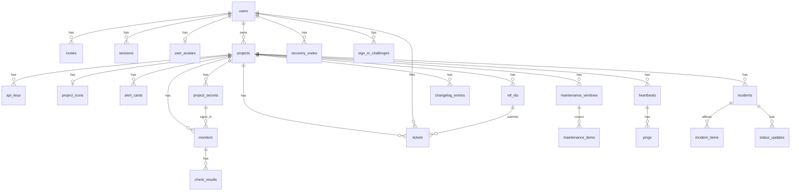
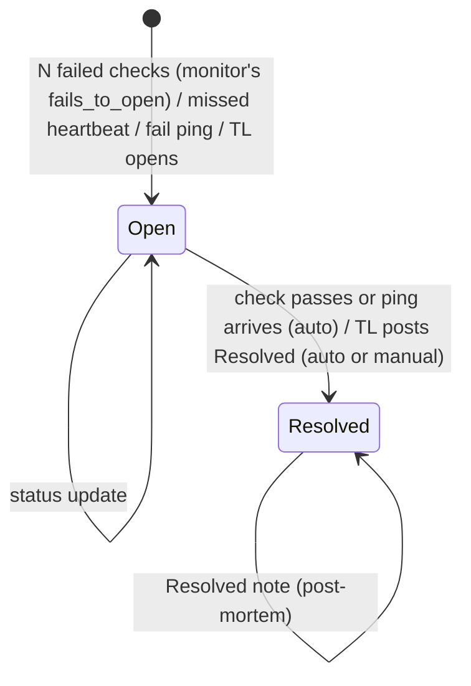
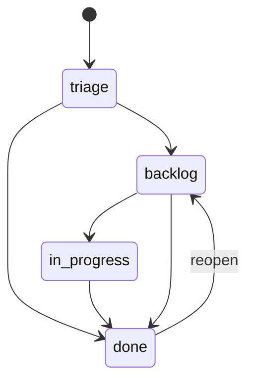

# 6. Data Model

## 6.1 Conventions

| Rule | Detail |
| --- | --- |
| Primary key | `id INTEGER PRIMARY KEY` |
| Time | `INTEGER`, UTC Unix seconds. Columns end in `_at`. |
| Booleans | `INTEGER` 0 or 1 with a `CHECK`. |
| Enums | `TEXT` with a `CHECK (x IN (...))`. |
| Common columns | `created_at` on every table, `updated_at` where rows change. |
| Secrets | Only SHA-256 hashes for API keys, invites, sessions and ref IDs. Heartbeat tokens are stored raw, because the TL must see the ping URL again. |
| Values Monita must send | Stored as entered, because a check or the mail server needs the real value: `project_secrets.value`, `monitors.headers`, `monitors.body`, `monitors.auth_user` and the mail password in `settings.mail`. See [07](07-security.md) SEC-23 to SEC-25. |
| Table rebuilds | SQLite cannot change a column `CHECK`. Migrations 0003, 0006, 0018 and 0022 rebuild `monitors`, `tickets` and `users`. Each copy keeps every id. |
| Foreign keys | `PRAGMA foreign_keys = ON`. `ON DELETE CASCADE` from a project to its children. |

## 6.2 ERD

`incident_items`, `incident_sources` and `daily_summaries` point at a monitor or a heartbeat through `(source_kind, source_id)`.

## 6.3 Tables

### 6.3.1 users

| column | type | nullable | default | key | notes |
| --- | --- | --- | --- | --- | --- |
| id | INTEGER | no | | PK | |
| email | TEXT | no | | UNIQUE | lowercased. `tl@company.co.id` |
| password_hash | TEXT | yes | | | NULL until the invite is used |
| role | TEXT | no | | | `super_admin`, `tl`, `supervisor`. A supervisor sees what a super admin sees and changes nothing ([09](09-authentication-and-authorization.md)). Migration 0022 rebuilt the table to add the value. |
| disabled_at | INTEGER | yes | | | |
| created_at, updated_at | INTEGER | no | | | |
| totp_secret | TEXT | yes | | | Base32. Set while two-factor sign-in is on; stored as entered (SEC-27). Migration 0027. |
| totp_pending | TEXT | yes | | | A secret shown but not yet confirmed with a code |
| totp_pending_expires_at | INTEGER | yes | | | 10 minutes after the secret was shown (v1.1 Q32). Confirm refuses it after; retention clears both columns. Migration 0035. |
| totp_step | INTEGER | yes | | | The last 30-second step a code was used for; only later steps pass |
| avatar_at | INTEGER | yes | | | When the user's picture last changed; NULL without one. Versions `/users/{id}/avatar?v=`. Migration 0034. |

`recovery_codes` (migration 0027): `id` PK, `user_id` FK users ON DELETE CASCADE, `code_hash` TEXT UNIQUE (SHA-256), `used_at` INTEGER NULL. Ten per user while two-factor is on.

`user_avatars` (migration 0034, v1.1 Q31): `user_id` PK, FK users ON DELETE CASCADE; `mime` TEXT CHECK `image/png` or `image/webp`; `data` BLOB, at most 32 KB. Apart from `users` so a user list never reads the bytes, like `project_icons`.

`sign_in_challenges` (migration 0027): `token_hash` TEXT PK (SHA-256), `user_id` FK users ON DELETE CASCADE, `expires_at` (5 minutes after a right password), `attempts` (wrong codes; the fifth deletes the row). Retention deletes expired rows.

### 6.3.2 invites

| column | type | nullable | default | key | notes |
| --- | --- | --- | --- | --- | --- |
| id | INTEGER | no | | PK | |
| user_id | INTEGER | no | | FK users | |
| token_hash | TEXT | no | | UNIQUE | |
| expires_at | INTEGER | no | | | created_at + 72 h |
| used_at | INTEGER | yes | | | |
| created_at | INTEGER | no | | | |

### 6.3.3 sessions

| column | type | nullable | default | key | notes |
| --- | --- | --- | --- | --- | --- |
| id | INTEGER | no | | PK | |
| user_id | INTEGER | no | | FK users | |
| token_hash | TEXT | no | | UNIQUE | |
| expires_at | INTEGER | no | | | created_at + 14 days |
| created_at | INTEGER | no | | | |

### 6.3.4 projects

| column | type | nullable | default | key | notes |
| --- | --- | --- | --- | --- | --- |
| id | INTEGER | no | | PK | |
| owner_id | INTEGER | no | | FK users | |
| name | TEXT | no | | | `Payments` |
| slug | TEXT | no | | UNIQUE | `^[a-z0-9-]{2,40}$`. Made at create: the name in lowercase letters, digits and dashes, cut to 33 characters, then `-` and 6 random base32 characters. `payments-k3x9qa` |
| ip_allowlist | TEXT | yes | | | Comma-separated CIDRs. NULL means off. |
| description | TEXT | yes | | | Up to 280 characters. NULL means none. |
| icon_at | INTEGER | yes | | | When the icon was last set. NULL means no icon; the value versions the icon's URL. |
| homepage_url | TEXT | yes | | | Where people use the project's system. `http://` or `https://`, up to 2 000 characters. New projects and the profile form require it. NULL for projects made before migration 0020; the status page links to it when set. |
| show_incidents | INTEGER | no | 1 | | The public Incidents tab. Off: the page JSON carries no incidents and the history answers 404. Uptime always shows. |
| show_known_issues | INTEGER | no | 1 | | The public Known issues tab (the tickets past Triage). |
| show_report | INTEGER | no | 1 | | The public Report a bug tab: the form and the reporter's own tickets, both behind a ref ID. Migration 0010 added `show_mine`; migration 0019 dropped it. |
| show_changelog | INTEGER | no | 0 | | The public Changelog tab. The column default 0 kept old status pages as they were; a new project is inserted with 1 (v1.1 Q28). |
| created_at, updated_at | INTEGER | no | | | |

A public route whose tab is off answers 404.

### 6.3.4a project_icons

The icon's bytes, apart from `projects` so a project list never reads them.

| column | type | nullable | default | key | notes |
| --- | --- | --- | --- | --- | --- |
| project_id | INTEGER | no | | PK, FK projects ON DELETE CASCADE | |
| mime | TEXT | no | | CHECK `image/png` or `image/webp` | |
| data | BLOB | no | | | At most 32 KB. The browser scales the picture to 128 px; the server checks the type and the size only. |

### 6.3.5 api_keys

| column | type | nullable | default | key | notes |
| --- | --- | --- | --- | --- | --- |
| id | INTEGER | no | | PK | |
| project_id | INTEGER | no | | FK projects | |
| name | TEXT | no | | | `backend-prod` |
| key_hash | TEXT | no | | UNIQUE | |
| key_prefix | TEXT | no | | | First 10 chars, for display. `mk_7hq2kz` |
| scope | TEXT | no | `ref_ids` | | `ref_ids`, `read` or `write` (v1.1 Q44, migration 0041) |
| last_used_at | INTEGER | yes | | | |
| revoked_at | INTEGER | yes | | | |
| created_at | INTEGER | no | | | |

### 6.3.6 alert_cards

Migration 0037 (v1.1 Q34) replaced `alert_routes`, the one row per severity, with cards. It made two `owner_email` cards per project, on where the route was on and listed the owner; an `email` card with a route's whole list when it held anyone but the owner alone; and a card per webhook URL, off when its box was unticked.

| column | type | nullable | default | key | notes |
| --- | --- | --- | --- | --- | --- |
| id | INTEGER | no | | PK | |
| project_id | INTEGER | no | | FK projects ON DELETE CASCADE | INDEX |
| kind | TEXT | no | | | `owner_email`, `email`, or a webhook format: `json`, `discord`, `telegram`, `telegram_bot`, `ntfy`, `pagerduty` |
| name | TEXT | no | | | 1 to 60 characters; `Owner email` for the owner's cards. The server fills it from the kind when the form sends none. |
| critical, warning | INTEGER | no | 0 | | The levels the card listens to |
| new_tickets, ticket_moves, digest | INTEGER | no | 0 | | The ticket events the card listens to (migration 0039, v1.1 Q37). Only an owner card has `digest`. |
| enabled | INTEGER | no | 1 | | The card's switch. Off keeps the card and sends nothing. |
| emails | TEXT | no | `''` | | An `email` card's addresses, one a line, 20 at most. Empty for other kinds; an `owner_email` card looks the owner's address up when it sends. |
| url | TEXT | yes | | | A webhook card's URL; `https://api.telegram.org/` for `telegram_bot`. A supervisor never sees it. |
| key | TEXT | yes | | | Telegram's chat ID or PagerDuty's routing key. A supervisor never sees it. |
| created_at | INTEGER | no | now | | |

Two CHECKs hold the rules. At least one of `critical`, `warning`, `new_tickets`, `ticket_moves` and `digest` is 1. A card never mixes `critical` or `warning` with a ticket event. The section is not stored. It is `incidents` when `critical` or `warning` is set, and `tickets` otherwise.

A project has five `owner_email` cards, which only change by their switch: critical and warning (on), and Daily digest, New tickets and Ticket moves (off for a new project). It also has at most `caps::ALERT_CARDS` (10) of its own in each section.

Migration 0039 (v1.1 Q37) rebuilt the table, because SQLite cannot change a CHECK, and dropped `ticket_alerts`. Incident cards keep their ids. The owner's Daily digest card is on when the old ticket alerts and their digest were on (a project with no row keeps it on). The owner's New tickets and Ticket moves cards start off. A saved ticket webhook URL became a ticket card in its format, named JSON webhook, Discord, Telegram, Global Telegram or ntfy. It listens to new tickets, moves or both, as ticked. With neither ticked, it became a card that is off and listens to new tickets, so the URL is kept.

### 6.3.7 monitors

| column | type | nullable | default | key | notes |
| --- | --- | --- | --- | --- | --- |
| id | INTEGER | no | | PK AUTOINCREMENT | Never reused (migration 0003): incident_items, incident_sources and daily_summaries name a source by kind and id without a foreign key. |
| project_id | INTEGER | no | | FK projects | |
| name | TEXT | no | | | `API health` |
| url | TEXT | no | | | `https://pay.internal/api/health` |
| interval_s | INTEGER | no | 60 | | `CHECK IN (30, 60, 180, 300)` |
| timeout_ms | INTEGER | no | 10000 | | 1000 to 30000 |
| expected_status | TEXT | no | `'2xx'` | | `2xx`, or a list like `200,204` |
| keyword | TEXT | yes | | | The response must contain this text. Up to 200 characters. |
| skip_tls_verify | INTEGER | no | 0 | | For self-signed internal endpoints |
| severity | TEXT | no | `'warning'` | | |
| is_public | INTEGER | no | 0 | | |
| next_check_at | INTEGER | no | | INDEX | |
| alert | INTEGER | no | 1 | | Its failures alert (migration 0009). Off: Monita tracks it and tells nobody. |
| auto_incident | INTEGER | no | 1 | | Its failures open an incident. Off: it goes Down on the team's pages and sends the Down and Up alerts only ([12](12-incident-engine.md)). |
| fails_to_open | INTEGER | no | 2 | | Failed checks in a row that count as down. `CHECK BETWEEN 1 AND 99`. Migration 0014 allowed 1, 2, 3 and 5; migration 0018 widened it by rebuilding the table. |
| method | TEXT | no | `'GET'` | | `GET`, `HEAD`, `POST` or `PUT` |
| headers | TEXT | yes | | | `Name: value` lines, as entered. At most 20 headers and 4 KB a value. `Host` and `Content-Length` are refused. |
| body | TEXT | yes | | | Sent with `POST` and `PUT` only. At most 64 KB, as entered. |
| auth_kind | TEXT | no | `'none'` | | `none`, `bearer`, `basic` or `header`. The secret named by `auth_secret_id` supplies the credential. |
| auth_secret_id | INTEGER | yes | | FK project_secrets ON DELETE SET NULL | Must belong to the monitor's project. A deleted secret fails the check with a fixed sentence. |
| auth_user | TEXT | yes | | | The user name for `basic`. No colon. |
| auth_header | TEXT | yes | | | The header name for `header`. A header row may not repeat it. |
| kind | TEXT | no | `'http'` | `IN ('http','tcp','dns','ping')` | `http`, `tcp` or `dns` (migration 0024, v1.1 Q16), or `ping` (migration 0029 rebuilt the table to widen the CHECK, v1.1 Q24). A TCP check keeps `host:port` in `url`; a DNS or ping check keeps the host. A ping check runs on every system, Windows too (v1.1 Q40). |
| expected_address | TEXT | yes | | | `dns` only: the check passes only when one A or AAAA answer equals it (migration 0024). |
| cert_warn_days | INTEGER | yes | | `IN (7, 14, 30)` | HTTPS only: warn this many days before the certificate expires (migration 0028, v1.1 Q25). |
| cert_expires_at | INTEGER | yes | | | The `notAfter` of the leaf certificate the last HTTPS check saw. |
| cert_warned_for | INTEGER | yes | | | The `notAfter` the last warning was about, so each certificate warns once. |
| paused_at | INTEGER | yes | | | Set while a tech lead has paused the monitor (migration 0040, v1.1 Q38). Null while it runs. See 6.3.8. |
| created_at, updated_at | INTEGER | no | | | |

### 6.3.7a project_secrets

Tokens and passwords that monitors sign in with. A value is written once and never shown again.

| column | type | nullable | default | key | notes |
| --- | --- | --- | --- | --- | --- |
| id | INTEGER | no | | PK | |
| project_id | INTEGER | no | | FK projects ON DELETE CASCADE | UNIQUE with `name`. At most 20 per project. |
| name | TEXT | no | | | 1 to 60 letters, digits, `_` or `-`. `REPORT_API_TOKEN` |
| value | TEXT | no | | | 1 byte to 4 KB, stored as entered (SEC-23). Only `projects::secrets::value_of` reads it. |
| created_at, updated_at | INTEGER | no | | | |

### 6.3.8 heartbeats

| column | type | nullable | default | key | notes |
| --- | --- | --- | --- | --- | --- |
| id | INTEGER | no | | PK AUTOINCREMENT | Never reused, as for monitors. |
| project_id | INTEGER | no | | FK projects | |
| name | TEXT | no | | | `nightly-report` |
| token | TEXT | no | | UNIQUE | 26-char base32 |
| period_s | INTEGER | no | | | 60 to 2 592 000 |
| grace_s | INTEGER | no | | | 0 to 86 400 |
| severity | TEXT | no | `'warning'` | | |
| is_public | INTEGER | no | 0 | | |
| last_ping_at | INTEGER | yes | | | |
| deadline_at | INTEGER | yes | | INDEX | NULL after a miss is reported, until the next ping. A hand resolve sets it to `now + period_s + grace_s` ([12](12-incident-engine.md)). |
| alert | INTEGER | no | 1 | | As for monitors (migration 0009) |
| auto_incident | INTEGER | no | 1 | | As for monitors |
| paused_at | INTEGER | yes | | | Set while a tech lead has paused the heartbeat (migration 0040, v1.1 Q38). Null while it runs. |
| created_at, updated_at | INTEGER | no | | | |

State words on the team's pages: `Up`, `Down`, `Issue`, `Maintenance`, `Paused` and `No data yet`. `Paused` wins over every other state. A monitor never checked and a heartbeat never pinged read `No data yet` (was "Waiting"). Migration 0012 gave each heartbeat that a hand resolve left with no deadline, and that was not down, a new one.

`paused_at` (migration 0040, v1.1 Q38) on `monitors` and `heartbeats` holds the Unix second of the pause, or null. While it is set: the scheduler and the location probes skip a monitor, the missed-heartbeat sweep skips a heartbeat, and no incident opens and no alert goes out. A ping to a paused heartbeat is stored and answered 200 but opens and closes nothing. Pausing closes the source's open automatic incident without a resolved alert (update message "Paused by a tech lead.") and resets its failure streak. Resuming makes a monitor due at once. A resumed heartbeat's `deadline_at` becomes now + `period_s` + `grace_s`. The project list's hourly bars count a source from `created_at` until `paused_at`, so an hour before it existed or while it was paused has no data. The status page hides a paused source. A maintenance window differs: checks keep running in a window.

`held_cause` (TEXT NULL, migration 0032): the failure text of a `/fail` ping received in a maintenance window, kept until the window ends and the incident opens with it; a success ping or a hand resolve (`rearm_heartbeat`) clears it.

### 6.3.9 check_results and pings

| table | columns |
| --- | --- |
| check_results | id, monitor_id FK, checked_at INDEX(monitor_id, checked_at), ok, status_code NULL, latency_ms NULL, error NULL, location_id NULL FK locations ON DELETE CASCADE INDEX(monitor_id, location_id, checked_at) (null: this server; migration 0030), in_window INTEGER NOT NULL default 0 (migration 0045) |
| pings | id, heartbeat_id FK, received_at INDEX(heartbeat_id, received_at), kind (`ok`, `fail`), source_ip, cause (NULL, the first 1 KB of a `/fail` body after leading whitespace), in_window INTEGER NOT NULL default 0 (migration 0045) |

Both keep 7 days. See [13 section 13.6](13-check-scheduler.md). Charts, daily summaries and the monitor list's last check read this server's results only (`location_id IS NULL`).

`in_window` is 1 when an active maintenance window covered the source at `checked_at` or `received_at` (v1.1 Q46, migration 0045). The row keeps its real `ok` or `kind`, so the checks table and the ping list still show the failure. Every count of good results (the charts, the sparklines, `check_slots`, `ping_slots` and the daily rollup) reads `ok OR in_window`, so a held failure counts as good. Rows from before the migration read 0. See [13 section 13.2a](13-check-scheduler.md).

### 6.3.9a locations and monitor_locations

Migration 0030, v1.1 Q26. Design: [14](14-locations.md).

| table | columns |
| --- | --- |
| locations | id AUTOINCREMENT, name UNIQUE, token_hash UNIQUE (SHA-256), token_prefix, last_seen_at NULL, created_at |
| monitor_locations | monitor_id FK ON DELETE CASCADE, location_id FK ON DELETE CASCADE, next_check_at, claimed_at NULL (the newest claim), open_claims (claims not yet answered, at most 2; migration 0031); PK (monitor_id, location_id); INDEX (location_id, next_check_at) |

`monitors.quorum` (INTEGER, default 1, 1 to 11): how many places must fail for a check to count as failed.

### 6.3.9b check_slots and ping_slots

Checks and pings summed per 15-minute UTC slot (`slot` = time / 900, migration 0046). The day and week charts, the project charts, the sparklines and the daily rollup read these. The hour chart reads the raw rows.

| table | columns |
| --- | --- |
| check_slots | monitor_id FK ON DELETE CASCADE, slot, total, good, timed (checks with a latency), ms_sum; PK (monitor_id, slot) |
| ping_slots | heartbeat_id FK ON DELETE CASCADE, slot, total, good; PK (heartbeat_id, slot) |

An `AFTER INSERT` trigger on `check_results` and on `pings` adds each row to its slot. Every insert path, the seeds too, keeps the slots right. Only this server's checks count (`location_id IS NULL`). A failure in a maintenance window counts as good, as on the charts. The retention sweep deletes slots older than 7 days with the raw rows. Release build, 3 M raw rows: the project list's chart went from 391 ms to 41 ms, a project's overview from 230 ms to 34 ms. Migration 0046 fills the slots from the raw rows in 11 s.

### 6.3.9c project_pins, monitor_pins and heartbeat_pins

A user's pins (decision Q48, migration 0048). Each table is `user_id` FK ON DELETE CASCADE, the target's id FK ON DELETE CASCADE, and `pinned_at`; PK (user_id, target id), with an index on the target. At most 6 project pins per user, and 6 monitor pins and 6 heartbeat pins per project per user (`caps::PINS`), checked inside the write that adds one. `project_pins` belongs to projects, the other two to checks.

### 6.3.10 daily_summaries

| column | type | notes |
| --- | --- | --- |
| source_kind | TEXT | `monitor`, `heartbeat`. PK part |
| source_id | INTEGER | PK part |
| day | TEXT | `2026-10-16`, UTC. PK part |
| checks_total | INTEGER | |
| checks_ok | INTEGER | |
| downtime_s | INTEGER | From incidents that overlap the day |
| avg_latency_ms | INTEGER NULL | Monitors only |

Uptime % for a day = `1 - downtime_s / 86400`. The status page computes the same figure live from incidents; this table keeps the history after raw rows are swept (US-32). Daily-job bookkeeping lives in `settings` outside the limits page: `last_<job>_day` (UTC date of the last success), `last_<job>_attempt_at` (Unix time of the last failure) and `rollup_through` (Unix start of the last summarized day).

### 6.3.11 incidents, incident_items, incident_sources, status_updates

| table | columns |
| --- | --- |
| incidents | id, project_id FK, origin (`auto`, `manual`), title, severity, cause NULL, started_at, resolved_at NULL, created_by NULL FK users, excluded NULL (`planned`, `false_alarm`; CHECK; migration 0044), excluded_at NULL, excluded_by NULL (the user's email or "API key <name>") |
| incident_items | incident_id FK, source_kind, source_id. PK all three |
| incident_sources | source_kind, source_id (PK), fail_streak INTEGER default 0, open_incident_id NULL FK incidents, down_since INTEGER NULL |
| status_updates | id, incident_id FK, label (`investigating`, `identified`, `monitoring`, `resolved`), message, author_id NULL, author_key NULL (the API key's name, v1.1 Q44, migration 0042; both NULL = Monita), created_at |

`excluded` is the class a tech lead gave the incident (v1.1 Q46). NULL counts as usual. `planned` and `false_alarm` leave availability, the charts, the pulse bars and the public status page and its history; the team's incident lists and pages still show them, tagged. Spec 12 section 12.3c has the rules.

`down_since` is when the source went down. A source with `auto_incident` off is down with no incident, so this column is the only record of it. A source counts as down while `open_incident_id` or `down_since` is set. A hand resolve and a passing check clear all three columns.

### 6.3.12 outbox

| column | type | notes |
| --- | --- | --- |
| id | INTEGER | PK |
| channel | TEXT | `email`, `webhook`, `telegram` (the global Telegram bot; migration 0036 rebuilt the table for it) |
| recipient | TEXT | Email address, URL, or a Telegram chat ID. A `telegram` row never holds the bot token; delivery adds it. |
| subject | TEXT NULL | Email only |
| body | TEXT | Plain text, or JSON for webhooks |
| attempts | INTEGER | default 0 |
| next_attempt_at | INTEGER | INDEX |
| sent_at, failed_at | INTEGER NULL | |
| last_error | TEXT NULL | |
| created_at | INTEGER | Rows older than 30 days are deleted |

`telegram_links` (migration 0036, v1.1 Q33; reshaped by 0037): `code_hash` TEXT PK (SHA-256 of a connect link's code), `project_id` FK projects ON DELETE CASCADE, `expires_at` (10 minutes after the link), `chat_id` and `chat_title` (set when the bot hears the code). A project has one open link: a new one deletes its older link and every expired one. The global Telegram bot itself is three `settings` rows: `telegram_bot_token`, `telegram_bot_name` and `telegram_offset` (the next update to read).

`telegram_chats` (migration 0049, security audit 2026-10-27): `project_id` FK projects ON DELETE CASCADE, `chat_id` TEXT, `title`, `proved_at`; PK (`project_id`, `chat_id`). A chat that one of the project's connect links found. A `telegram_bot` card may only name such a chat. The migration counts the chats of existing `telegram_bot` cards as proved, so no alert stops.

### 6.3.13 ref_ids and tickets

| table | columns |
| --- | --- |
| ref_ids | id, project_id FK, token_hash UNIQUE, single_use, used_at NULL, revoked_at NULL, created_at, tail NULL |
| tickets | id, project_id FK, number (UNIQUE with project_id), ref_id NULL FK, created_by NULL FK users, title, public_title NULL, description, page_url NULL, stage (`triage`, `backlog`, `in_progress`, `done`), close_reason NULL (`fixed`, `wont_fix`, `duplicate`), created_at, updated_at |

`ref_ids.tail` holds the last 4 characters of the raw ref ID, so the team can tell ref IDs apart. Ref IDs made before migration 0017 have none; the page shows their issue date. The ID has 26 random characters, so 4 known characters leave 110 bits unknown.

A reporter's ticket has a `ref_id` and no `created_by`. A ticket the team files from the board has a `created_by` and no `ref_id` (migration 0006). The table `CHECK (ref_id IS NULL OR created_by IS NULL)` enforces it. Team-filed tickets have no daily caps and send no webhook. A ticket in `done` has a `close_reason`, and no other ticket has one: `CHECK ((stage = 'done') = (close_reason IS NOT NULL))`.

UI label for `stage`: "Column".

### 6.3.13a changelog_entries

A project's releases, shown on the public Changelog tab one at a time, newest first (migration 0021).

| column | type | nullable | default | key | notes |
| --- | --- | --- | --- | --- | --- |
| id | INTEGER | no | | PK | |
| project_id | INTEGER | no | | FK projects ON DELETE CASCADE | UNIQUE with `version` |
| version | TEXT | no | | | 1 to 40 letters, digits, `.`, `_` or `-`, starting with a letter or digit. `latest` is refused: the public route uses it for the newest release. |
| released_on | TEXT | no | | | `YYYY-MM-DD`, as typed. Not a Unix time. |
| title | TEXT | no | | | Up to 120 characters |
| sections | TEXT | no | | | JSON `[{"tag": "Added", "items": [...]}]`. Tags in order: Added, Changed, Fixed, Removed. Up to 30 items of 500 characters in each. |
| created_at, updated_at | INTEGER | no | | | |

### 6.3.13b maintenance_windows and maintenance_items

Planned work on a project (migration 0026, v1.1 decision Q18). Owned by the `maintenance` module. The state is not stored: `scheduled` while now < `starts_at`, `active` until `ends_at`, then `ended`. End now sets `ends_at` to now.

| column | type | nullable | default | key | notes |
| --- | --- | --- | --- | --- | --- |
| maintenance_windows.id | INTEGER | no | | PK | |
| project_id | INTEGER | no | | FK projects ON DELETE CASCADE | |
| title | TEXT | no | | | Up to 120 characters; public |
| message | TEXT | no | `''` | | Up to 1000 characters; public |
| starts_at, ends_at | INTEGER | no | | | CHECK `ends_at >= starts_at`. A new window is at most 30 days long. |
| created_at | INTEGER | no | | | |
| maintenance_items.window_id | INTEGER | no | | PK, FK maintenance_windows ON DELETE CASCADE | |
| source_kind | TEXT | no | | PK | `monitor` or `heartbeat` |
| source_id | INTEGER | no | | PK | No FK: sources are another module's. Their ids are AUTOINCREMENT, so a row left by a deleted source covers nothing. |

### 6.3.14 settings and schema_migrations

| table | columns |
| --- | --- |
| settings | key TEXT PK, value TEXT. Limit keys, with the label the Rate limits page shows: `check_concurrency` (50, "Checks at the same time"), `rl_key_per_min` (120, "API calls per minute from one key"), `rl_ping_per_s` (1, "Pings per second for one heartbeat"), `tickets_per_ref_per_day` (5, "Bug reports per user per day"), `tickets_per_project_per_day` (100, "Bug reports per project per day"). Every value is 1 to 1 000 000; `check_concurrency` is 1 to 500. |
| settings (raw keys) | Not on the limits page. `utc_offset_min`: minutes east of UTC that pages show times in, -720 to 840 in quarter hours, default 0. `mail`: JSON of the mail server a super admin saved (`host`, `port`, `security` of `tls`, `starttls` or `none`, `user`, `password`, `from`, `skip_verify`); the key is absent when none is saved. `last_digest_ticket_id`: the digest watermark. |
| schema_migrations | version INTEGER PK, applied_at |

## 6.4 State machines

### 6.4.1 Incident

Class is a second field and does not change this machine. A tech lead can set it on an open or a resolved incident (spec 12 section 12.3c).

Rules are in [12](12-incident-engine.md).

### 6.4.2 Ticket

The code allows a move from any column to any other. The diagram shows the usual path. Entering `done` needs `close_reason`. Leaving `done` clears it. A move to another column sends `ticket.moved` when the ticket webhook listens for moves. A ticket is public when `stage != 'triage'`.

## 6.5 Indexes

`monitors(next_check_at)`, `heartbeats(deadline_at)`, `check_results(monitor_id, checked_at)`, `check_results(checked_at)`, `pings(heartbeat_id, received_at)`, `pings(received_at)`, `outbox(sent_at, failed_at, next_attempt_at)`, `tickets(project_id, stage)`, `tickets(ref_id, created_at)`, `changelog_entries(project_id, released_on DESC, id DESC)`, `maintenance_windows(project_id, ends_at)`, `maintenance_items(source_kind, source_id)`.

## 6.6 Migrations and seeding

Rule: migrations are numbered files in `migrations/`, embedded at compile time with paths relative to the source file, and applied by one runner inside the binary. The database path comes from the environment.

`platform::migrate::run` applies each pending file in its own `Db::write_without_fk` transaction and records it in `schema_migrations`. Foreign keys are off during a migration, because a table rebuild (SQLite's generalized ALTER TABLE procedure) drops a parent table, which would otherwise cascade. A rebuild copies every row with its id, so references stay valid.

| Command | Effect |
| --- | --- |
| `monita serve` | Runs pending migrations, then starts. |
| `monita migrate` | Runs pending migrations and exits. |
| `monita setup` | Writes the env file and creates the first super admin ([api-specs 10.2](../api-specs/10-cli.md#102-monita-setup)). |
| `monita admin create --email` | Creates a super admin. Reads the password from stdin. |
| `monita admin reset-password --email` | Sets a new password for an existing super admin and signs them out. A TL resets through a new invite. |
| `monita admin reset-sign-in --email` | For any active user who lost the authenticator and the recovery codes. Turns two-factor off, ends sessions, stops the old password, and queues an invite email. |
| `POST /admin/reset-state {"seed":"dev"}` | Dev and test only. Wipes, migrates, loads `seeds/dev.sql` or `seeds/qa.sql`. |

Forbidden: running a `.sql` file by an absolute path outside the runner, and creating tables in application code.

`seeds/dev.sql` and `seeds/qa.sql` are idempotent, embedded with `include_str!`, and hold one super admin, one TL, one project, two monitors, one heartbeat and three tickets. Seed passwords are documented in `seeds/README.md` and work only outside prod, because reset-state does not exist there.
